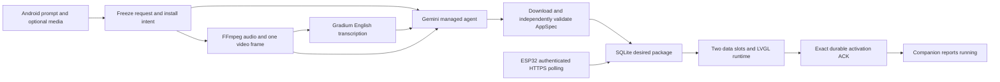

# Implemented architecture and remaining integration checks

This architecture prioritizes a complete path that can be verified within the hackathon day. The user has confirmed an Android phone and a Waveshare ESP32-P4-WIFI6-Touch-LCD-3.5 with camera and battery. ROM queries confirmed revision 3.2 and 16 MB flash. The configured firmware compiled and flashed; the user reports its built-in tap app works. Two managed generations and public HTTPS readiness passed. Downloaded-app activation, Android input and real Gradium speech remain integration checks; current evidence belongs in [the work ledger](12-work-ledger.md).

The main interaction is **Generate and install** for a selected, paired device. That single action authorizes generation and automatic installation of the validated, reversible app package. There is no required transcript confirmation, follow-up question, or preview approval. Headless deterministic behavior simulation and physical-device tests are required; interactive preview is an optional P1 diagnostic feature.

## Companion and backend

The implementation uses Python 3.9 standard-library HTTP/REST clients, SQLite, private upload storage and a vanilla HTML/CSS/JavaScript companion served from the same process. The provider integration does not depend on `google-genai`. Node is used for JavaScript verification, not to run the service.

The backend owns provider credentials and the authoritative sessions, jobs, packages, and deployments. Gemini/Gradium credentials never reach the browser or device. A single process and worker with SQLite are sufficient for the MVP. The worker records each stage and recovers coherently after errors or restart. Hosting this design requires persistent storage and one instance, or an explicit external store; an ephemeral cloud filesystem is not a durable database.

In-browser camera/microphone access needs a secure origin, normally HTTPS. The Mac's HTTP LAN address opened on the phone is not equivalent to localhost. Offer upload from the gallery/camera first; test integrated recording on the actual Android phone. Sources: [getUserMedia](https://developer.mozilla.org/en-US/docs/Web/API/MediaDevices/getUserMedia), [capture](https://developer.mozilla.org/en-US/docs/Web/HTML/Reference/Attributes/capture).

Negotiate recording MIME types at runtime and test actual decoding beyond `MediaRecorder.isTypeSupported()`. The implemented video reduction sends one midpoint JPEG frame to the managed agent and separately produces mono 24 kHz WAV for Gradium; it does not analyze a full video sequence. Source: [MediaRecorder](https://developer.mozilla.org/en-US/docs/Web/API/MediaRecorder/isTypeSupported_static). FFmpeg is installed; real format-conversion and overlength-rejection checks pass. Actual Android capture is still a separate gate.

Use an HTTPS endpoint reachable by both phone and board. The selected implementation uses the Mac backend and a temporary Cloudflare tunnel. After venue QUIC failures, HTTP/2 connected and the launcher verified the exact public asset before publishing the private QR link. Protect the demo session and preserve a local copy of its data. The device can use a 2.4 GHz hotspot with Internet access without needing direct phone-to-device connectivity.

## Understanding and generation

1. The user submits the prompt and any media with **Generate and install**. The backend freezes the input revision, paired target device, and install intent. Later edits cannot alter that job.
2. When audio is present, Gradium transcribes the supported language selected for the demo; English is accepted by the user. Manual transcript correction and revision are deferred P1 features. Text-only generation does not require fabricated audio or a transcription call.
3. The generator combines the prompt and Gradium transcript, infers trusted behavioral requirements, and supplies images directly to the managed agent. It does not implement a separate model-produced ConceptBrief or chat conversation stage. The one-shot flow requires no confirmation turn. Unsupported runtime actions fail validation; general semantic fidelity remains a limitation beyond the explicit tap-game checks.
4. The managed agent receives the request, visual input, schema, capabilities and trusted validation files in its remote environment. It writes `out/app.json` and must execute `trusted_check.py`; the backend checks the paired execution result and exact artifact hash. The [actual provider adapter](../backend/generator.py) owns the request shape.
5. The backend retrieves the artifacts, reapplies structural and semantic validation, executes deterministic scenarios, and assigns the published version/hash. The agent cannot certify its own result.
6. If validation passes and this job remains the latest authorized intent for the selected device, the backend automatically publishes its desired package. The optional preview follows the same behavior contract; visual equivalence must still be tested on hardware.
7. The companion reports success only after the matching active ACK. Generation completion and installation completion remain distinct states.

The implemented agent mounts support capability inspection, package validation, scenario execution, and artifact saving. Mounting provider skills alone would not provide the AppSpec validator. Actual managed generation now supplies the public project files and verifies execution plus artifact retrieval; see [the evidence](research/managed-probe.md).

## First demo: a 10-second tap game

The candidate requires only existing v1 primitives and three screens: ready, play, result. Start resets the score, resets the timer, starts it, and navigates to play: four actions. Each completed tap on the play button adds one point. The timer's completion navigates to result, which reads the final score. Play again uses the same four-action sequence.

Timers are registered from the whole AppSpec before any screen is shown, so Start can target the timer on the not-yet-rendered play screen. A monotonic deadline governs completion; timeout processing precedes a tap at or after the deadline. These details and fixture expectations belong to the [canonical contracts](04-contracts.md), not to separate simulator or firmware interpretations.

## Firmware and runtime

One ESP-IDF firmware initializes the BSP, LVGL, network, and storage. Keep UI/LVGL work, app state/actions, and communication/installation as separate responsibilities. Network results reach the runtime through a queue or the BSP's supported mechanism; no unprotected concurrent LVGL changes.

The firmware includes a shell for connection status, pausing the app and recovery. Pairing is preprovisioned before the demo. It downloads AppSpec, checks limits, schema/runtime compatibility and the hash, then prepares the candidate UI. Two slots for **data packages** are not two firmware OTA partitions. The implemented two-slot store uses a dedicated 512 KiB NVS partition. A microSD card is not required.

Use the activation transaction defined in [the contracts](04-contracts.md): persist and validate the candidate, record a pending activation while retaining the current package, prepare the initial view, commit the active pointer after successful activation, then ACK. An interrupted pending activation boots into the previous package or recovery shell. Repeated delivery of an already active package must not reset a running game.

Navigation, variables, and timers execute locally. The runtime does not execute generated JavaScript/C, load arbitrary libraries, or accept arbitrary URLs/commands. Installation errors preserve the old app; unsupported content never reaches execution. After successful installation the game continues to work without cloud connectivity.

PSRAM does not imply a browser exists on the board. A generated phone web app is not automatically executable on the ESP32. Hardware details and alternative runtime approaches: [hardware research](research/hardware.md).

## Connection and installation

Phone and device communicate through the backend. The device polls HTTPS with its own credentials; the companion observes the deployment. This avoids requiring browser Bluetooth or requests from an HTTPS page to a local HTTP device.

Bootstrap uses separate random session and device bearer tokens in private local configuration. The private QR link supplies the browser token as a URL fragment; the device token is compiled into its private configuration. One session is bound to one board. Expiring display-code pairing and multiple accounts are not implemented.

The device waits two seconds between polling cycles and uses bounded connection/request timeouts. The same Generate and install request authorizes automatic publication after validation. The server preserves the target identity and orders device intents so an older, slower job cannot overwrite a newer request. The desired response contains deployment identity, ordering sequence, and manifest. The firmware stages, validates, activates, persists, and acknowledges that exact deployment.

If the ACK is missing, show Waiting for device. If ACK delivery fails after activation, later polling/heartbeats repeat the result without reinstalling or resetting app state. Historical ACKs cannot complete a different or superseding deployment.

Espressif provides an HTTP client with HTTPS and certificate verification. Test the CA bundle, device time, and connectivity with the pinned IDF version; do not disable verification to make TLS errors disappear. Source: [ESP HTTP Client](https://docs.espressif.com/projects/esp-idf/en/stable/esp32p4/api-reference/protocols/esp_http_client.html). The stable link can advance: implementation must use documentation matching its pinned version.

## Decisions and alternatives

| Topic | Current choice | Alternative and condition |
| --- | --- | --- |
| Device apps | Declarative JSON | Lua/WASM after the runtime and complete demo work |
| App updates | Data packages | Firmware OTA for engine updates, outside the first path |
| Capture | Android phone | Board camera/microphone as a later extension |
| Transport | HTTPS polling | USB through the Mac if radio bring-up is blocked; disclose the limitation |
| Voice | Gradium English | Italian via Gemini plus a real Gradium TTS feature only if later requested and verified |
| Agent | Selected managed agent, aligned with the brief's emphasis | Backend-executed Gemini tools if the managed route becomes unusable; record the fallback and retain real tool/validation evidence |
| Preview | Optional diagnostic output | Preview-only mode can be added without changing the default single action |
| No physical board | Simulator for development | Does not satisfy the physical-device completion gate |

## Resource limits

All project limits, including upload size, package size, screen/widget counts, timer behavior, and concurrency, are defined once in [docs/04-contracts.md](04-contracts.md). Provider limits are separate facts. Reject requests outside the project budget with a readable explanation; never silently truncate input or artifacts.
