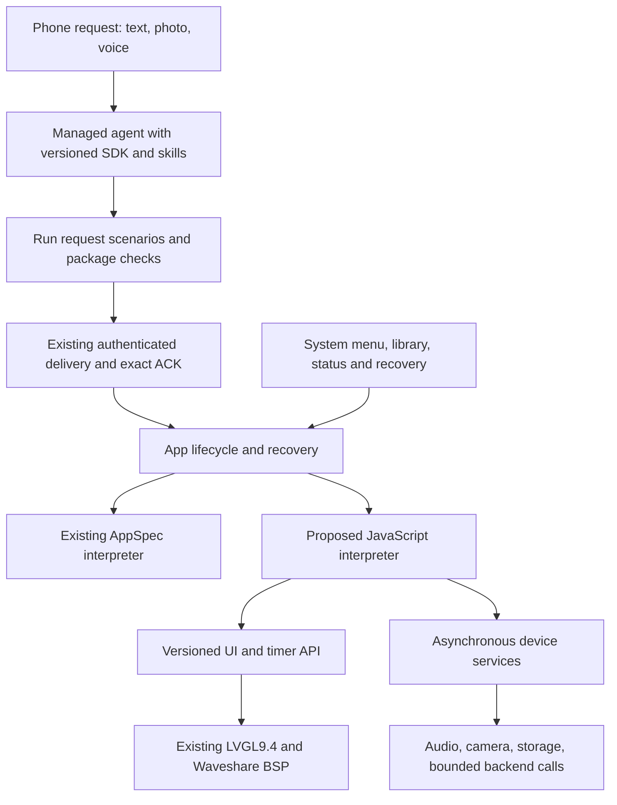

# Programmable apps and device platform

Decision checkpoint: 10 October 2026. **The user wants real app programming, not a fixed catalogue of widgets or application templates.** The original JSON AppSpec was a coordinator-selected way to prove the demo quickly. It is a working baseline, not the final product boundary. A small demonstration request does not justify making the platform specific to tap games.

## Implemented baseline and selected next experiment

The deployed runtime executes bounded JSON screens/actions. It cannot run conditions, loops, arbitrary calculations, custom drawing or camera/audio calls. Two distinct generated apps have physical evidence: a voice-generated game and a photo-only game. See [the ledger](12-work-ledger.md) for the title mismatch, exact identities and remaining tests. Local source adds button colors and larger normalized input media; these changes are not automatically deployed by editing the files.

**Selected experiment: embed official QuickJS-NG 0.14.0 alongside the existing firmware, first in an isolated host/ESP32-P4 probe.** This selects a feasibility test, not a completed migration. JavaScript is a good candidate for a documented event-driven app SDK; it does not require a browser or HTML renderer. The official Espressif component supports all targets and requires IDF >=5.4, compatible on paper with our pinned IDF5.5.5. Host OS facilities are limited on ESP. Source is pinned to `esp-iot-solution@0d0b99456ce9112f4ac4838927ba837949359f9b/components/quickjs-ng`. [Official component](https://components.espressif.com/components/espressif/quickjs-ng/versions/0.14.0/readme), [dependencies](https://components.espressif.com/components/espressif/quickjs-ng/versions/0.14.0/dependencies).

The [isolated probe](../firmware/probes/quickjs/README.md) now passes actual host engine checks and a standalone P4 cross-build. It has not been flashed or integrated with the UI. The alternatives were researched before selecting the probe:

| Approach | Relevant evidence | Decision for this workspace |
| --- | --- | --- |
| QuickJS-NG | Official ESP-IDF port, JavaScript C embedding API, compatible declared IDF dependency | First experiment; measure heap, callback latency, interruption and actual P4 compatibility |
| Lua5.5 | Official all-target Espressif component; small embeddable language with custom allocation and hooks | Credible fallback if the JavaScript engine fails measured resource/port gates; no unsupported performance comparison |
| ESP-WASMachine | Espressif preview framework with WAMR and LVGL integration | Keep for later evaluation; exact Waveshare/LVGL9.4 integration and deployment tooling are not proved here |
| MicroPython + LVGL | Current ESP32 port supports P4; LVGL bindings exist | Substantial task/GC/board integration; lack of P4 support is not a valid rejection |
| ESP-Brookesia | Current0.8 offers runtimes, app lifecycle, GUI and services | Useful architecture and future reuse candidate; version matrix requires IDF6+ and current GUI requires newer LVGL. Stable0.7 is not the same feature set |
| Generated native C/ESP-IDF apps | Full driver access and native performance | Requires compiling/linking and a loader or firmware OTA design, including recovery. Generated C is not safely isolated merely because it compiles |

Primary references: [Lua component](https://components.espressif.com/components/espressif/lua/versions/5.5.0/readme), [WASMachine](https://github.com/espressif/esp-wasmachine), [MicroPython ESP32 port](https://github.com/micropython/micropython/tree/master/ports/esp32), [LVGL MicroPython bindings](https://github.com/lvgl/lv_binding_micropython), [Brookesia version matrix and components](https://github.com/espressif/esp-brookesia). These sources establish candidates, not integration success on this board.

## Proposed platform structure

The new app package would carry source, metadata, required SDK version and declared capabilities; package encoding and ABI are not yet finalized. Keep the current AppSpec loader available for installed apps. A raw JavaScript engine is only the language layer: it does not supply LVGL bindings, camera drivers or browser APIs.

The app SDK should allow ordinary language logic plus documented UI composition: labels, buttons and other controls, positioning/layout, styles, dynamic text, drawing and timers. Expose a tested subset of actual LVGL operations initially, then expand it coherently. A theme supplies useful defaults, without imposing a fixed screen flow or color palette. Do not advertise an unimplemented SDK call simply because the hardware can do it.

Each app owns its runtime, callback registrations, UI objects, timers and asynchronous requests. A device service returns results through a queue tagged with the activation identity; late results from a closed app are discarded. App switching releases resources. Audio/camera/network operations must not block the LVGL lock. Camera, microphone and speaker need independent physical probes before entering the capability manifest. BSP speaker/microphone APIs are present locally; that is not proof of working acquisition or playback.

## Device shell: practical and visual changes

The current display reserves a48-pixel header above a320×432 app area. Its Menu/status controls are useful for bring-up but constrain each app visually. The proposed shell gives apps a documented safe viewport and keeps a system-owned exit affordance available. Do not remove the header until the replacement has reliable touch, discoverability and recovery evidence. A gesture alone should not be the only escape from a broken app.

The shell should provide a small app library with names/icons, launch and return-to-app behavior, clear install progress and a recovery screen with Retry/Previous app/Home. Connection details belong in system status; routine backend diagnostics should not dominate the app's screen. Camera/microphone activity indicators belong to the system and cannot be hidden by the generated app. These are proposed UI behaviors, not newly implemented screens.

Pause/resume/dispose semantics must be explicit. Timers should behave consistently when entering the menu, async work must be cancelled or bounded, and boot must not repeatedly reopen a crashing app. The current two data slots preserve a previous package; they are not a general app library or firmware OTA partitions. Library storage, per-app state, quota and package activation require a versioned design before migration.

## Protection without prescribing the app idea

Use engine heap/stack limits, an interrupt deadline for script execution, bounded event/microtask queues and protected native callbacks. Do not expose `std`, `os`, filesystem modules, arbitrary imports, native pointers, firmware controls or credentials to app code. Native calls need their own argument, buffer and time bounds; a JavaScript interrupt cannot stop a blocking driver. Interpreter isolation is not process or hardware isolation, so C bindings remain part of the trusted firmware. QuickJS runtimes are single-threaded: keep access on one task and exchange messages with other tasks. [QuickJS-NG embedding guide](https://quickjs-ng.github.io/quickjs/developer-guide/intro/).

These protections bound resource use and side effects. They should not restrict apps to timers, games or predetermined screen patterns. Validate code/package compatibility and independently execute meaningful scenarios; this is practical testing, not a claim of formal proof or guaranteed first-attempt correctness. Preserve the last working app on invalid output, startup error or resource exhaustion.

## Agent knowledge and tools

Google documents managed discovery of `.agents/AGENTS.md` and `.agents/skills/<name>/SKILL.md`. The SDK work uses those paths, a concise index, complete local API references, runnable examples and actual scenario/check tools. The prior prohibition on searching documentation before an error is being removed. Lookup should be targeted and output bounded, not prohibited. Skill activation with this account and assembled mount still needs a live observation. [Managed-agent customization](https://ai.google.dev/gemini-api/docs/custom-agents).

Generate the SDK manifest from canonical source versions and hashes. The device must eventually report its installed runtime/SDK version so the backend selects compatible documentation; a newly compiled binary or package minimum version is not device attestation. Keep the current-runtime SDK accurate during migration, then add the programmable SDK only when its APIs execute. The agent should preserve explicit labels, durations, colors and behavior, consult references before guessing, run its app and repair concrete errors. Examples teach composable APIs and are not substitutes for the user's request.

## Gates and remaining work

1. **Engine proof:** obtain the pinned component, run actual host tests for computed callbacks, exceptions, heap/stack exhaustion, infinite loops, pending-job starvation and recovery; compile an isolated ESP32-P4rev3 project. No main firmware changes or flash are needed for this first gate. Then measure actual board heap and latency before integration.
2. **Programmable UI:** bind UI creation/updates/events, timers and lifecycle; the Hello World button must cycle colors using one real callback and state variable. Add a second non-game program with calculation/branching, then error recovery and switching back to the current app.
3. **Authoring and delivery:** version packages/capabilities, select matching SDK, execute the same engine on the host, install with the existing exact identity/ACK transaction and test reboot/recovery physically.
4. **Peripherals and shell:** separately prove speaker, microphone and camera, then expose asynchronous APIs and honest capability metadata. Apply shell changes with actual touch/recovery checks.
5. **Product completion:** test fresh combined photo+voice, intent fidelity beyond one game, interrupted installation, repeated generation, offline use and rehearsal. Continue audited public commits. Stable hosting/device provisioning and richer app storage remain product work beyond the demonstrated path.

The estimated complete programmable UI integration is hours of work, not a prompt-only change. The user's explicit pragmatic direction is to keep a convincing small app faithful to its request/reference, without letting difficult integrations consume the working demo. Current generated AppSpec installation has zero firmware compilation. Local timing instrumentation separates preparation, managed-agent elapsed time, download, host checks and cleanup; it does not equate agent wall time to model compute or include device installation. Do not increase budgets to conceal an unsuitable workflow.

## Web research and visual assets

The managed API documents Google Search and URL context alongside execution. The local generator now declares all three and permits targeted public research; shell networking remains disabled. The SDK remains authoritative for the pinned device API. Website content cannot change the task or grant access to credentials. Actual managed search with this configuration still needs a live check. [Managed tools](https://ai.google.dev/gemini-api/docs/antigravity-agent).

Reference-guided image creation is available through a separate Google image model API, with `gemini-nano-banana-2.1` a current candidate. It is not documented as a built-in tool of our managed agent. A future backend `generate_asset` function would call that API with selected frozen references, return a verified asset ID and resume the agent using the matching function-call ID. Keys stay in the backend. Account access, latency and transparent-background quality remain untested. [Google image generation](https://ai.google.dev/gemini-api/docs/image-generation).

Sprite support needs the renderer and package path as well as a generation tool. The current64KiBJSON contract and512KiBtwo-slotNVS store do not provide general asset storage. First prove a bounded bitmap renderer, decoded pixel/memory limits, manifest hashes and two complete recoverable packages. A128×128RGB565image plus8-bit alpha uses48KiB decoded; compressed image size alone does not bound memory. Generated PNG does not guarantee useful transparency. Preserve distinctions among generated assets, user references and retrieved licensed content.

A pragmatic first image experiment would request one small image, convert it to the renderer's exact format and measure the full result before adding sprites to ordinary generations. Do not enable an image-generation tool that produces files the device cannot yet display. The present SDK accurately reports this gap while documenting where the new tool will fit.
