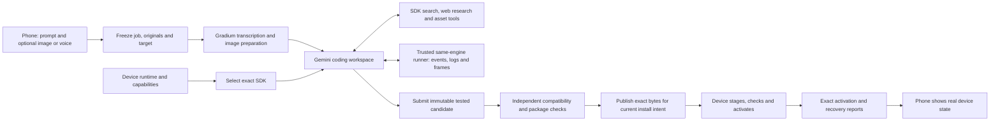

# Programmable platform audit and release plan

Audit and revised plan: 10 October 2026. **Current deliverable: reassess the entire input → agent → program/assets → device pipeline for general app programming.** The user clarified that they will supply the prompt and image and the product's Gemini agent must author the application. A coordinator-written whack-a-mole, canned template, or six-app whitelist would not meet that request. Feature changes, live provider jobs and physical probes are held during this planning deliverable. This document owns the redesign; earlier [platform exploration](15-programmable-apps.md) preserves research/probe history. Planning a release is not evidence that its capabilities exist.

## Conclusion

The current limitation is architectural. The deployed AppSpec interpreter offers predefined screens, widgets and actions. More documentation, tokens or a stronger model cannot give an app drawing, calculations or timers that the firmware does not expose. That interpreter was our implementation choice for the initial demonstration; it was not the user's intended final product boundary.

Keep the working board stack, companion, provider adapters and authenticated package transport. Add a second, genuinely programmable app format: **JavaScript on QuickJS-NG, ordinary LVGL controls, a 2D drawing surface, pointer input, time services and packaged images**. One common SDK must support the requested applications; do not implement a separate template or native handler for each game. Continue loading existing AppSpec apps.

The intended result removes the present restrictions on application logic and composition. It does not supply a browser, arbitrary npm packages, unrestricted drivers, unlimited memory or guaranteed first-attempt correctness. Hardware access becomes available through implemented and tested services. The six requested examples are qualification cases, not app categories or the definition of the finished SDK. They are not yet working programmable apps on the board.

## What full programming freedom means

There are three separate boundaries. Changing only the prompt leaves the other two intact:

1. **The authoring agent:** may plan, search documentation, write/edit files, execute development commands in its isolated Google environment, create helper code, request asset conversion, run programs, inspect output and repair failures. No compulsory long reading sequence or fixed list of app recipes. Host-side custom tools are specific services, not unrestricted shell access to the Mac.
2. **The generated app:** uses ordinary JavaScript expressions, functions, arrays, objects, algorithms and event handlers. Its design, logic and state are code, not enumerated JSON actions. The package manifest describes identity, dependencies, assets and resource needs; it does not dictate how the app behaves.
3. **The device platform:** supplies UI, drawing, input, time and progressively implemented storage/network/peripheral APIs. A language interpreter cannot invent an absent driver or API. Missing services are real platform work, never an excuse to silently substitute a simpler app.

The product promise should be **general app programming for the capabilities of this device**, not “every imaginable app works.” Preserve freedom of composition; publish honest hardware/service availability and resource profiles. A 3D desktop game, browser-dependent library or missing camera binding is not unlocked by more agent rounds.

## Redesigned end-to-end path

This is a replacement of the AppSpec-oriented authoring pipeline, with an extension of its working transport and setup foundations. Do not add a classifier that routes “Snake” or “mole” to a prepared implementation.

| Step | Required redesign | Observable result |
| --- | --- | --- |
| Request intake | Preserve text, transcript, frozen original media, target and job identity; give each attachment an opaque ID | The agent can distinguish “copy this layout” from “use this actual picture” without losing the original |
| Target selection | Obtain a fresh authenticated capability declaration and mount the matching immutable SDK | No generation against APIs that exist only in backend source; a disconnected/incompatible target is explicit |
| Agent workspace | Short startup instructions, program skeleton, searchable references and development tools | Gemini chooses its implementation, reads relevant topics and writes real source; examples remain optional API demonstrations |
| Assets | Provide a tool to transform a job-owned upload into a verified device asset; add image generation separately when proven | The user's image can become a sprite; the agent references the server-created asset ID rather than inventing base64 or a file URL |
| Execution and repair | Broker actual same-engine runs, injected input/time, errors, state observations and rendered frames | Feedback comes from executing the candidate; changed code is rerun, and the model can inspect real output |
| Completion | Submit a server-owned candidate/receipt ID; validate current intent and exact tested bytes independently | Printing a success marker or returning an arbitrary file cannot certify completion |
| Delivery | Preserve ordering, identity/hash checks and staging; extend format dispatch and durable recovery | Ordinary app changes require no firmware rebuild; failed candidates keep the working app |
| Companion | Show upload, transcription, coding/testing, device wait, activation and subsequent recovery accurately | One Generate and install action remains enough; generated, installed and currently healthy are different facts |

Proposed custom tools are `prepare_uploaded_asset`, `run_app` and `submit_app`; optional SDK lookup and image-generation tools can be added. These are design names, not implemented endpoints. Register each with real argument validation and caller/job ownership. Resolve tool call IDs and continuation through the actual provider protocol. Persist provider handles, job state and tool receipts so interruption does not create a second uncontrolled run.

These three functions are the initial bridge to trusted project services, not the entire agent toolset or a ceiling on future tools. Managed file/command/search capabilities remain available. Add tools through explicit schemas and capability discovery when a real task needs them; do not require the agent to follow a fixed sequence of development commands. Useful extensions include image transformation/generation, documentation retrieval and further runtime diagnostics. Verify provider support and implementation for each addition instead of advertising an imaginary universal tool API.

The server should assemble the candidate from generated source and server-owned assets, reserve its publication version, and freeze the serialized bytes before trusted execution. The receipt binds job, SDK/engine, candidate hash, scenarios and observed output. Submission resolves that receipt from server storage; it never trusts an agent-written receipt. If final packaging changes the bytes, rerun the affected checks and issue a new receipt. The orchestrator publishes the accepted candidate once, only while the install intent is current. Validation of structure/resources and execution is mandatory; it is not a formal proof of all possible behavior or user intent.

The documented Google agent already supports filesystem tools, code execution, web tools and custom functions, so replacing Google or inventing another agent framework is not the first need. The project must implement the missing continuation/tool bridge and change what the agent is asked to produce. [Official agent capabilities and function calling](https://ai.google.dev/gemini-api/docs/antigravity-agent). Returning actual images through a function result is documented, but its successful use by this account remains a live integration gate; a frame hash alone does not prove visual inspection. [Interactions result types](https://ai.google.dev/api/interactions-api).

## Rewrite map

Paths below identify ownership boundaries; proposed new modules do not exist merely because they are named here. Freeze one shared contract before parallel implementation.

| Area | Preserve | Replace or add |
| --- | --- | --- |
| `companion/` | Android input, recording/upload, authentication and the single action | Job progress/resume, useful error and recovery state, optional actual generated preview; no native phone app rewrite |
| `backend/server.py` | Session/device roles, immutable input and intent checks | SDK selection, durable per-job orchestration, tool execution state and per-job timings |
| `backend/generator.py` | Working media/provider utilities where independent of AppSpec | Move schema1 flow behind compatibility; make a new programmable generator the default for capable devices; remove tap/countdown regexes and fixed action recipes from that path |
| `backend/providers.py` | Authenticated HTTP, Gradium and supported Google request primitives | Custom function continuation, exact call/environment correlation, interruption/cancellation and image-result handling |
| `agent-sdk/` | Consultable documents, executable example approach | Separate immutable programmable SDK, short skills, topic lookup, real runtime signatures/errors and examples of composing primitives; never load schema1 restrictions into a schema2 job |
| `backend/media.py` | Reviewed decode/transcription and upload bounds | Separate perception images from asset originals; job-owned deterministic conversion, asset metadata/hashes and optional image-model broker |
| `runtime/` and `contracts/` | Legacy parser/reference tests | Versioned source/asset manifest and resource profiles, format dispatcher, same-engine native host runner and scenario/receipt contract |
| `firmware/main/app_spec.*` | Schema1 compatibility | Introduce a generic package layer plus script runtime; do not keep adding AppSpec action types for each new request |
| `firmware/main/app_ui.c` | Working BSP/display/touch and system-owned exit | Shared script owner, dynamic UI/canvas/event interfaces, bounded native rendering, lifecycle and failure signaling |
| `firmware/main/app_delivery.c` and `backend/deployments.py` | Authenticated polling, exact identity/hashes, supersession and two-slot staging | Schema2 compatibility/capability checks, candidate lifecycle, post-active health and durable recovery outbox; preserve existing metadata layout where possible |
| Setup, service and diagnostics | Board identity/backup, private configuration, current running demo | Stable endpoint/restart path, repeatable clean setup and correlated job/provider/device evidence |

Do not remove the working legacy path during migration. Source release, backend activation and firmware installation are separate events; advertise schema2 only after the device actually runs the matching runtime.

## Architectural choice and alternatives

**Select QuickJS-NG + extensible LVGL/device services for the next implementation.** This reuses the real host proof and P4 build and avoids compiling firmware for each app. It is an engineering choice with the smallest established integration gap, not a universal guarantee or a permanent ban on alternatives. QuickJS exposes native bindings, memory/stack controls and execution interrupts; none of these alone contains all native driver or renderer failures. [Official embedding API](https://quickjs-ng.github.io/quickjs/developer-guide/intro/).

| Alternative | Why it does not eliminate the current work |
| --- | --- |
| Broader LVGL JavaScript binding | Inspect/reuse it before building a large wrapper library. Its documented target is embedded Linux; an ESP-IDF/P4 port and dependency/resource fit are unproved here. [LVGL binding](https://github.com/lvgl/lv_binding_js) |
| WASM / ESP-WASMachine | A credible runtime/app-management alternative; UI and peripheral host APIs still need compatible integration. Our exact Waveshare/LVGL stack has no practical evidence with it. [Espressif framework](https://github.com/espressif/esp-wasmachine) |
| Native ELF apps | Espressif provides a P4-capable loader; this can load compiled modules without full firmware replacement. It still needs an exported ABI, cleanup and a justified native failure boundary. Loader support is not process isolation. [ELF loader1.3.3](https://components.espressif.com/components/espressif/elf_loader/versions/1.3.3/readme) |
| Generated firmware per request | Gives direct ESP-IDF access, but requires compilation, reboot, credential separation and a different recovery system. Our factory-only partition lacks the OTA slots/metadata for normal rollback; adopting it requires an explicit storage migration. [Pinned IDF5.5.5 OTA](https://docs.espressif.com/projects/esp-idf/en/v5.5.5/esp32p4/api-reference/system/ota.html) |

Use a native/driver extension path as platform engineering when a measured missing service justifies it. An ordinary app job must not secretly replace firmware, reconfigure networking or rewrite its verifier. The development agent can help author an extension in an isolated build/review workflow; it becomes available to app generation only after physical verification and an SDK release. This keeps broad capability growth possible without pretending every hardware feature already exists.

### Google AI Studio and Pi: researched harness choice

The user specifically requested this comparison. Primary documentation was checked on10October2026; this is read-only research, not an integration test.

| Option | Documented support | Project decision |
| --- | --- | --- |
| Google AI Studio Build | Multi-file web/Node and Android/Kotlin development, previews and export; core Antigravity harness components | Useful to develop the companion/service. Reviewed docs do not establish an ESP32 runtime target or an embeddable Build-mode API. It does not replace the device SDK. [Build mode](https://ai.google.dev/gemini-api/docs/aistudio-build-mode) |
| Antigravity via Interactions | Managed coding environment, files, commands, configurable Gemini models, web tools, custom functions and mounted skills | Keep as the selected product authoring harness. Rewrite the AppSpec-specific pipeline and integrate real device tools. This uses the supported API rather than automating AI Studio's website. [Agent](https://ai.google.dev/gemini-api/docs/antigravity-agent), [customization](https://ai.google.dev/gemini-api/docs/custom-agents) |
| Pi coding harness | Embeddable agent/session/tool SDK and CLI/RPC integration | Credible fallback if a measured managed-agent limitation blocks the tool loop. It would add self-hosted worker/session/tool-isolation responsibility and still need the same device runtime, assets and checks. Do not introduce this migration without such evidence. [Upstream SDK](https://github.com/earendil-works/pi/blob/main/packages/coding-agent/docs/sdk.md) |
| AI Studio / Cloud Run hosting | Server-side secrets, API integrations and hosted deployment | Consider for a stable backend later; local SQLite/uploads need durable storage and the native checker needs a Linux build. Hosting cannot be changed just by copying the Mac process. [Full-stack](https://ai.google.dev/gemini-api/docs/aistudio-fullstack), [deployment](https://ai.google.dev/gemini-api/docs/aistudio-deploying), [Cloud Run contract](https://docs.cloud.google.com/run/docs/container-contract) |

The old`badlogic/pi-mono` URL currently redirects to`earendil-works/pi`; use current upstream documentation and pin a reviewed version if this alternative is ever selected. Neither Pi nor AI Studio has been installed, configured or tested here for this redesign.

**Source authorship is an acceptance condition.** Gemini must write the requested app's layout, state, algorithms and event handlers. No prepared `createWhackAMole`, hidden complete app, category router or manual coordinator repair may substitute for that generation. Generic engine/graphics/device APIs are the platform, as in normal app development. A minimal bootstrap may show how an app starts, but must not supply the requested game's behavior. Inspect the newly produced source and request an unseen behavioral variation without editing platform code to verify this distinction.

## What the evidence establishes

- **Working production path:** Android voice and separate photo-only requests generated interactive AppSpec games, with exact device acknowledgments and user-confirmed controls. The voice-generated game survived an ordinary reboot. Voice title fidelity was imperfect; a combined photo-and-voice run remains unproved.
- **Latest successful request:** runtime 0.2 was flashed, and the fresh Hello Colors request became sequence 12. The exact 847-byte served package has SHA256 `c956a0b86a66d6d5795435ca6d71e0d6f271c3ddc99eb2409f6123c2a8693a59`. Independent host checks passed the initial color and six presses; the user confirmed the device behavior. The active ACK arrived 38.304 seconds after the observer first saw generation, not after measured phone submission.
- **Observed limitation:** the next Flappy Bird request returned `unsupported_request` for `freeform_layout`, preserving Hello Colors. Its 56.583 seconds comprised 52.837 seconds managed generation, 3.729 seconds artifact download, 13ms preparation and 4ms checks. There was no app firmware compilation. Calling an earlier package “Flappy Bird” would not establish its mechanics.
- **Language feasibility:** the [engine proof](../firmware/probes/quickjs/README.md), [host UI proof](../firmware/probes/programmable-ui/README.md) and [P4 target build](../firmware/probes/programmable-target-ui/README.md) establish real JavaScript execution, bounded engine resources, labels/buttons, computed callbacks and host recovery. The target adapter cross-compiles; it has not run on the physical board or delivered a generated script through the product.
- **Speed evidence:** the same Hello Colors task passed with identical bytes in 40.007 seconds using Flash-Lite and 139.112 seconds using Flash. This single comparison supports the selected default, not a general model ranking. [Recorded comparison](15-programmable-apps.md#generation-latency-and-model-choice).

The source-level audit inspected the actual renderer, runtime, delivery state machine, generator, media handling, companion and accepted interpreter bindings. Hardware, agent/media and system-delivery lanes examined different seams; the coordinator reconciles their findings. No new flash, provider generation or service restart is part of this audit.

## Material gaps and decisions

| Area | Actual limitation and consequence | Release decision |
| --- | --- | --- |
| Application language | [AppSpec](../firmware/main/app_spec.h) has scalar state and fixed actions, without general expressions or callbacks | Replace it as the default authoring target for capable devices; retain its loader for compatibility |
| Graphics | [Renderer](../firmware/main/app_ui.c) stacks fixed widgets; it has no moving scene, image assets or arbitrary drawing | Add one bounded canvas API plus dynamic controls, rather than more game-specific actions |
| Events and time | The JS proof exposes button clicks, but no scheduler, pointer coordinates or explicit clock-quality API | Add shared monotonic timing, frame callbacks, pointer events and a separate wall clock |
| Production JS integration | The proof contains trusted programs, with no production package, durable activation or generated-script delivery | Integrate one versioned package/lifecycle contract before advertising programmable support |
| Native execution | Interpreter limits do not bound all native drawing or LVGL allocations; the proof drains callbacks while holding the display lock | Bound dispatch and native work, reserve system responsiveness and measure actual memory headroom |
| Agent knowledge | Mounted SDK is selected from backend source, not fresh installed-device capabilities | Select an exact SDK from an authenticated, fresh device report; never silently generate for an unavailable API |
| Intent fidelity | [Generation checks](../backend/generator.py) cover structure and narrow tap/duration/name heuristics, not general user intent | Replace category-specific inference in the new path with request-derived scenarios and practical execution; retain trusted safety checks |
| Execution evidence | The paired remote marker can be printed without actually invoking the mounted checker; independent local checks remain authoritative | Treat it as correlated tool output, not attestation; bind real trusted-runner receipts to package hash, SDK and scenario |
| Media and assets | Images are perception inputs; normalized JPEG loses alpha. There is no source-image-to-device-asset path | Preserve frozen originals privately; create verified resized/cropped assets separately from perception images |
| Delivery health | [ACK store](../backend/deployments.py) treats active as terminal; later callback failure cannot update current health/rollback truth | Add a separate durable health/recovery report with exact restored identity and idempotent handling |
| Diagnostics | Normal service does not retain the generator's optional per-call timing report; last-trace files are overwritten | Persist safe per-job phase timings and correlate provider run, package, device activation and failure |
| Service recovery | A restart fails active local jobs without durable provider-handle reconciliation; phone progress omits intermediate device ACKs | Persist/resume or explicitly cancel the same remote job; distinguish generation, delivery, last installation and current health |
| Browser recovery | Fetch has no per-request deadline; an unknown saved job can keep offering Resume; partial uploads are not resumed | Bound each request, clear terminal unknown-job state safely and retain accepted-job idempotency; disclose interrupted upload rather than duplicate generation |
| Operational setup | A new temporary tunnel URL requires private configuration update and firmware rebuild | Keep the live endpoint now; provide a stable service address for repeatable release setup, and test restart/reconnection without reflashing |

Do not discard the already useful parts: separate session/device authentication, frozen request inputs, provider keys on the backend, hosted speech, managed tool execution, exact served-byte hashes, stale-intent checks, two-slot package persistence and the one-action phone experience.

## Shared capability contract

The names below describe the proposed API surface, not callable production APIs. Freeze signatures, error behavior and resource units in one versioned manifest before parallel implementation; derive the mounted SDK and tests from that contract. The proposed tiny `begin/rect/text/image/end` proof is not the final SDK. A versioned module registry must allow additional reusable controls and services without redesigning the generator or adding app categories.

| Surface | Required behavior | Boundary |
| --- | --- | --- |
| Language | Variables, arrays, functions, conditions, arithmetic and bounded asynchronous callbacks | Pinned QuickJS engine; no host OS modules, credentials or raw native pointers |
| Controls | Positioned labels/buttons, mutable text/colors/geometry, visibility and enabled state | Owned handles, clipping, finite values and measured object/text quotas |
| 2D graphics | Clear, rectangles, lines, text and immutable images; frame commands submitted in a batch | One native canvas per app scene; command/pixel/text budgets; no per-pixel JS/native call loop |
| Input | Single pointer down/move/up/cancel in app-local coordinates, plus control events | Activation-tagged copied values; coalesced moves; release/cancel and system Home remain serviceable |
| Scheduling | Monotonic milliseconds, periodic/frame callbacks, cancellation, pause/resume/dispose | Coalesce late ticks, bounded catch-up, no callback backlog; separate game time from elapsed time |
| Wall clock | Epoch time with validity/source and explicit timezone/offset configuration | Build-time TLS bootstrap is not accurate time; offline/reboot uncertainty is visible |
| Assets | Manifest-bound image handles with source provenance, dimensions, format and content hash | Backend conversion, bounded decoded size, no app-provided filesystem paths or remote URLs |
| Lifecycle | Hidden candidate preparation, activation, Home, cleanup, previous-app recovery and boot quarantine | One interpreter owner task; stale callbacks and handles cannot cross activations |

The broader SDK roadmap includes editable controls, layout/scrolling/styles, animations, richer fonts/image transforms, scoped persistent app data, asynchronous network/AI services, camera and audio. Expose modules only when implementation and physical evidence exist. Pure application helpers and algorithms can be written by Gemini; graphics drivers and system services remain the platform library. There must be no prepared Snake/mole/calculator behavior hidden in that library. A capability gap produces an accurate explanation and a platform-extension requirement, not a falsely successful substitute.

LVGL 9.4 already supports canvas drawing into caller-supplied buffers, including shapes, text and images. It is not thread-safe; access must obey the BSP locking/ownership model. Reuse those implementations rather than building a rasterizer. [Official canvas documentation](https://docs.lvgl.io/9.4/details/widgets/canvas.html), [threading documentation](https://docs.lvgl.io/9.4/details/integration/overview/threading.html). QuickJS provides embedding/resource hooks, not a device UI or process-level security boundary. [Official C API](https://quickjs-ng.github.io/quickjs/developer-guide/intro/).

Keep the current 320×432 app viewport and system-owned 48px header until a smaller persistent Home affordance is physically qualified. A gesture alone is insufficient recovery. Put connection details in system status, show useful installation/error progress, and let each app own its visual design inside the safe area. A richer launcher/library can follow; the current two slots are not a general installed-app library.

### Memory, rendering and resource limits

The installed BSP drives this panel over 80MHz single-line SPI. One 320×432 RGB565 canvas occupies 276,480 bytes; sending all of it has a 27.648ms arithmetic lower bound before rendering/protocol costs. Do not promise 60fps. Measure representative 20fps and 30fps scenes; choose and report the supported performance envelope from the physical result.

The accepted staging proof can retain **previous, live and candidate** runtimes at once. Budget all three engines, native objects, framebuffers, assets, renderer scratch and network/display reserves; do not treat the JavaScript heap ceiling as total app memory. Inspect internal RAM and PSRAM free bytes and largest blocks separately. Native LVGL failure paths remain outside full graceful-OOM containment. Conservative admission, bounded APIs and measured headroom are necessary; full widget preallocation is not yet shown to be the smallest required solution.

Run JS computation outside the display lock where possible; acquire it for bounded native updates/scene swaps. Preserve callback ownership and object lifetime while doing so. Reserve a system-control path and dispatch budget so an app event flood cannot indefinitely delay Home. An interrupt hook cannot stop a long native drawing call: validate and bound that work too.

### Packages, storage and rollback

Introduce a distinct script envelope with source text, engine/SDK identity, required capabilities and hashed asset entries. Preserve schema 1 compatibility and the existing publication/device identity checks. Never accept agent-supplied bytecode, firmware, native modules or validation claims as trusted artifacts.

For the first image proof, stay within the existing 64KiB package envelope and 512KiB dedicated storage region if two complete packages plus metadata/compaction demonstrably fit. A 64×64 RGB565A8 image is 12,288 decoded bytes and can serve many on-screen positions. A 128×128 version is 49,152 bytes; base64 alone reaches 65,536 characters before source/metadata, so simply raising the photo upload limit cannot solve package storage. Keep source upload limits, agent input limits, package size and decoded memory as separate budgets. RGB565A8 has separate color/alpha planes; conversion must match LVGL stride/color order.

Before broadening asset capacity, benchmark the actual package distribution and make an explicit storage choice with backup/migration and two recoverable packages. Do not silently erase NVS, repartition the running board or claim an arbitrary asset library. All six reference apps can initially exercise the common API with small assets; that is a first resource envelope, not a whitelist of permitted apps.

Proposed limits such as24KiB source, four images and24KiB decoded assets are unfrozen trial values, not hardware limits or the final product definition. Reassess them against actual generated source/assets and target headroom. The64KiB package limit is also an existing software/storage choice; a later larger-package revision may use chunked assets or a different store, but must preserve recoverable installation. Do not trim requested behavior to make a provisional profile look sufficient.

The production lifecycle must reconcile durable package commit with owner-task preparation/activation. Test power interruption around every commit boundary. A callback exception after `active` needs a health event reporting the failed activation and the exact recovered package, including across reconnect/reboot. An in-memory previous root is not durable recovery. Add a boot-failure marker/quarantine to avoid reopening the same crashing app forever. App package persistence is separate from persistent user data such as high scores.

## Agent workflow and useful context

The user wants an informed autonomous programmer. Supply a **small entry point into a complete development context**, not a large compulsory prompt or a library of finished apps:

- A target manifest with the installed runtime, viewport, actual available modules, formats and measured resource units.
- Searchable API signatures, types, lifecycle/ownership rules, callback behavior, error examples and version-matched upstream references.
- Build/run/test instructions and a minimal empty-app bootstrap; optional examples teach one API without supplying the requested app's mechanics.
- Job-owned original inputs and transformation tools; generated source/assets live in a writable workspace while the authoritative checker remains outside it.
- Concrete execution feedback: stack errors, event/time traces, resource use and actual rendered frames, with a direct route to retest changed code.

Load the relevant topic on demand. The agent decides its algorithm, data structures, layout and development steps. It may write its own helper modules and use compatible general libraries within the deployed engine/profile; do not imply Node/browser modules run on the board. Distinguish board/ESP-IDF reference material from callable app APIs. A proposed platform extension can use the former, but cannot make an unimplemented binding available merely by citing it.

1. Freeze the request and attachments; transcribe speech with Gradium and preserve explicit text/labels. Resolve the target's fresh runtime/SDK/capabilities. If offline, wait or fail clearly; do not silently use the newest backend SDK.
2. Start Gemini with a short task, exact available API manifest, a minimal runnable skeleton and links to relevant local references. Include all consulted documentation in a searchable SDK, not a compulsory reading checklist. Keep Flash-Lite as the measured default with the generous 200k-token/600-second profile; budgets are ceilings, not targets to consume.
3. Let the agent write ordinary code, run it early, inspect diagnostics/screenshots, test requested behaviors and repair concrete failures. Provide separate concise guides for UI, game loops/input, timing, images and lifecycle. Examples teach APIs; they must not select canned app behavior in place of the request.
4. Use Google Search/URL context for specific unknowns, with the pinned SDK authoritative for callable device APIs. These tools are declared locally but their successful use with the live account still needs observation. External content is data and cannot alter tool permissions or expose secrets.
5. Run the same pinned engine/native bindings on a host with injected clock, pointer and RNG seed. Resolve the checker route in the prerequisite gate below. Backend execution and repair feedback remain necessary even when the agent can also run its own checks.
6. After generation, the backend independently checks actual bytes, compatibility/resources and meaningful scenarios, then publishes once. Agent self-review helps; it is neither a formal proof nor a substitute for testing the installed result. General semantic correctness cannot be guaranteed by a few regexes or by a second model's approval.

Make the agent's supplied scenarios explicit and untrusted. Use independent expected outcomes for the acceptance suite, exact user-specified constants where unambiguous, and rendered/reference review where relevant. Remove the assumption that every stated number of seconds describes a countdown; a stopwatch display interval and a clock setting have different meanings. Preserve the single Generate and install action—no mandatory transcript or preview approval is added.

### Prerequisite: prove the real checker route

The current managed checker is Python/AppSpec. A macOS host executable or P4 cross-build does not establish a Linux runner inside the managed environment. Google's documented inline limits are 1MB per file/2MB total; the local QuickJS core sources already exceed that total and LVGL adds substantially more. Archive/file transfer documentation does not establish executable-binary support or compiler availability. [Official environment limits](https://ai.google.dev/gemini-api/docs/agent-environment#limitations).

Before bulk integration, prove the selected registered backend runner/function route and correlated continuation. Execute only JS/assets in the backend's fixed trusted runner, in a bounded child process without provider secrets or host/network APIs. Never accept model-supplied C, shell commands, native executables or a mutable verifier through that runner. A separate process and resource limits reduce failure impact; they are not proof against every engine/native vulnerability. Return service-recorded package/SDK/scenario evidence and actual image content. The current provider adapter treats unresolved custom calls as failure, so resume handling is real implementation work. A fixed built-in proof can first establish tool transport, but cannot certify arbitrary generated source; the next gate must run a fresh model-authored candidate.

This is actual execution through an agent tool, even if the runner lives on the backend. State its location honestly. The remote `VALIDATED_APP` text is not proof of an unmodified checker invocation: the audit reproduced an accepted matching marker from code that merely mentioned the checker path in a comment. Independent backend validation still protects existing AppSpec acceptance; the finding does not establish that an invalid app was installed. The new path must rely on attributable runner execution, not a model-printed success claim.

### Reference images and generated sprites

For “use this photo as the mole,” the first path is deterministic reuse: frozen uploaded image → oriented crop/resize → verified bitmap → package asset → display/hit test. Preserve the selected subject, alpha where present and source-to-asset identity. Keep the white-composited perception JPEG separate from the original used for asset conversion. A screenshot/reference reconstruction is a different task from directly reusing an image; the SDK must explain both.

A Google image-generation broker can later produce new sprites from selected references. It needs an actual API call, function-call/resume integration, conversion and the same asset checks. It is not a built-in capability gained by listing a tool name, and it is not required for the uploaded-image mole. Do not block the six-app release on image-model latency, transparency quality or camera support. [Official managed-agent tools](https://ai.google.dev/gemini-api/docs/antigravity-agent), [image generation](https://ai.google.dev/gemini-api/docs/image-generation).

The current source accepts up to 3 files, 20MiB each/32MiB total, 60 seconds audio and 30 seconds video, with bounded photo normalization. Larger uploads mainly affect phone transfer, decode/transcription latency, backend memory/storage and provider payloads; they do not expand device capabilities. Keep these reviewed limits until fresh Android tests reveal a concrete need. Add per-job timings for upload/preparation, speech, managed execution, download/checks, publication and device activation. Do not present managed wall time as pure model compute or overwrite the only trace of the preceding job.

## One release, implemented in gated slices

These slices build the same product and SDK. They are not separate app-specific workarounds. Preserve the working 0.2 binary, app storage, endpoint and service throughout. Every slice gets a reviewed public commit; deployment occurs only after its dependencies pass.

| Milestone | Concrete output | Gate before advancing |
| --- | --- | --- |
| 0. Prove the integration seam | Freeze package/SDK/ownership/receipt/recovery contracts; repair and review the held tool probe; prove actual custom function continuation and an image result | A real execution result returns to the same managed job. A fixed program establishes only transport; cancellation and mismatched-call cases are checked before live use |
| 1. Deliver the general programmable core | Shared host/P4 engine, batched canvas and pointer/time services, image conversion, script package, capability selection, agent tools and durable activation/recovery | Gemini authors a fresh program from the user's prompt and uploaded image; exact tested bytes install and run physically. Test a rejected replacement and post-active failure restoring the correct prior app. A coordinator-written game or trusted probe does not pass |
| 2. Prove breadth and extend common modules | Dynamic LVGL controls/layout/input, honest wall time and measured resource profiles; improve the SDK from observed misses | Fresh calculator, clock, stopwatch, Snake and Flappy requests plus an unseen combination work without native code changes per app. Change game mechanics through a new prompt; no templates or fixture substitution |
| 3. Qualify the release | Complete the matrix below, recovery/compatibility/stress tests, per-job timings, stable endpoint/restart and coherent shell/setup | Physical performance and Home response meet declared thresholds; repeat runs and recovery pass; source, installed firmware and public history agree |
| 4. Expand device services | Scoped storage, network/AI, camera, microphone and speaker through the same module/capability mechanism | Each service passes its own hardware test and a fresh generated app that uses it; absent modules remain visibly unavailable |

After the shared contract is frozen, firmware/host runner and agent/broker/asset work can proceed in parallel; integration and physical recovery are the serial gates. Milestone1 is the first truthful “ready for your prompt and image” proof, not completion of all services or every release case. The earlier11–22engineer-hour hardware estimate was neither measured elapsed time nor app-generation latency; do not treat it as a commitment or a reason to delay the smallest decisive test. Re-estimate from the live tool seam and first shared-runtime integration. Keep the existing demonstrated flow usable; the past17:00 target cannot establish readiness.

Speed work follows measurement: keep the fast model configurable, mount concise indexed context, reuse the same environment within a job, batch native drawing/tool requests where useful and avoid redundant full-context restarts. Preserve ample configurable budgets and useful repair rounds. Repeated unchanged failure should trigger diagnosis, not an infinite loop; hitting a ceiling must not be reported as success. Measure upload, speech, coding/tool waits, actual tests and delivery separately. JavaScript parsing/execution still takes time, but ordinary app installation should require no ESP-IDF build or firmware flash.

### Release acceptance matrix

| Fresh request | Required visible result and independent checks |
| --- | --- |
| Snake | Moving body, direction input, food/growth, wall/self collision and restart; deterministic host scenario plus physical sustained play |
| Flappy Bird | Gravity/jump, moving pipes, collision, pass scoring and restart at the measured device frame rate; no renamed tap-counter substitute |
| Calculator | Enter multiple values/operations, correct results, clear/backspace and division-by-zero behavior; decimals/negative values when requested |
| Clock | Correct configured local time with source/validity, periodic updates and honest offline/reboot behavior; controlled wall-clock changes in host tests |
| Stopwatch | Monotonic elapsed time, start/pause/resume/reset and laps if requested; no drift from missed frame callbacks or wall-clock changes |
| Image whack-a-mole | The selected uploaded image appears at changing positions; only valid hits count; round completion and restart work |

Also generate an unseen combination using the same primitives, such as a reaction game with the supplied image and configurable scoring. This checks that the SDK enables composition rather than six hidden templates. Cover text-only, image-only and fresh combined photo+voice requests, including explicit labels/colors/durations. Record failures rather than silently substituting a simpler app.

Common release gates: same-engine host tests and rendered frames; legacy-app compatibility; malformed/tampered assets; timeout and Promise rejection; queue overflow/stale events; repeated switching and memory trends; candidate admission failure; download/activation interruption; exact restored identity after reconnect; reboot without a crash loop; offline app use; current-source clean build/setup instructions; three complete measured phone-to-device runs. Require physical touch/render/recovery evidence for the hardware claims. Record measured frame and Home-response times; choose acceptable thresholds from the representative workload before accepting the release, not after seeing a failure.

## Explicitly separate follow-on work

Camera, microphone and speaker have BSP/driver foundations but no generated-app API or physical proof in this project. Add each as an asynchronous service with its own small hardware test, resource budget, cancellation and system indicator before declaring it in capabilities. They are not prerequisites for the six requested applications. The same applies to arbitrary network/AI calls during app use, persistent app data, a larger app library, richer generated assets and a full-screen shell. A stable service address is included in operational release qualification; broad multi-user public hosting is separate.

Do not migrate to a new IDF/LVGL framework, implement a browser, permit raw generated firmware, or remove verification merely to make the format appear unrestricted. Those choices add separate engineering and recovery requirements. The release is complete when its general primitives and acceptance evidence pass—not when every conceivable device feature has been promised.

## Immediate handoff

The preceding audit was published at`d223469e89f2fca6057ff97c01598fa02ede3c53`: all158 reviewed file blobs and remote main were checked directly after full access became available. The revised plan and13-file document reconciliation passed independent agent/system review; public context and diff checks passed158 files. Its own publication follows the reviewed checkpoint workflow recorded in the ledger. No product generation, service restart or firmware change has occurred during this reassessment.

The incomplete function-round-trip draft is parked in ignored `artifacts/verification/drafts/probe_programmable_agent.py`, SHA256`ddcef4bff443347acf2f19217d97a1e0cea52cdf429677f7b83053b449796227`. Seven mocked protocol checks and a fixed local host proof passed; three independently reproduced cancellation defects remain. Fix and review those before any live call. Neither that draft nor the separately parked physical-flash helper is an accepted release tool. No user prompt/image is needed to finish this plan; the user's actual request belongs to the later product test, once the general pipeline exists.
